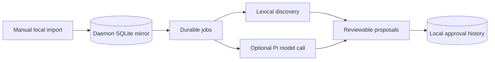

# Slowclaw multi-runtime harness — first implementation

## Roles

**iPhone:** Owns canonical journals, source revisions, capture, on-device inference and approved edits.

**Static browser (`web/`):** IndexedDB drafts and embeddings, with the existing authenticated/encrypted phone WebRTC connection. No daemon connection yet.

**Local daemon (`agent/`):** Local-only replica of *explicitly imported* passages, durable SQLite jobs, scheduler, audit history, reviewable proposals, opt-in Pi text reflections. Runs continuously **while its host remains powered on and awake**.

**Pi:** An optional interchangeable subprocess model backend, not the owner of journals or a general shell-running agent in this version. Every Pi job requires an explicit consent flag, and Pi runs with tools/extensions and other discovered resources disabled. The configured model may be remote.

## Actual data flow today

**There is no automatic daemon → iPhone synchronization.** An accepted local proposal never silently edits a phone journal or publishes anything.

## Next integration milestones

1. Define a versioned phone/browser/daemon contract for device identity, signed capabilities, journal revision, deletion propagation, proposal references, and authenticated receipts.
2. Extend the existing encrypted phone-peer WebRTC transport with explicitly granted daemon replication. Do not send journal plaintext through Cloudflare signaling.
3. Implement per-source permission grants, expiry, logout/disconnect behavior and secure deletion procedures for replicated journal data.
4. Surface the proposal approval inbox on the phone, and reconcile accepted changes back to the canonical source only with a user-approved, revision-bound operation.
5. Use EmbeddingGemma or another local embedder for better suggestions while retaining journal source references, deduplication and quality checks.
6. Package the daemon for reliable OS startup (Windows Task Scheduler first, then launchd/systemd). A powered-off laptop is not an always-on host.

## Risks, validation and rollback

The localhost API uses bearer authorization and same-origin request checking; **never expose it on the LAN**. Raw journal text resides in a local, unencrypted SQLite file and, for approved Pi jobs, may be transmitted to Pi's chosen model provider. Pi is disabled by default.

The Node tests exercise import revision conflicts and atomicity, repeat suggestion deduplication, job checkpoint recovery, scheduler bounds, review persistence, and API authorization. The Pi adapter is mock-tested; live Pi/model compatibility and real iOS/WebRTC integration have **not** been validated.

Rollback requires no iOS deployment: stop `agent/` or remove the feature branch. `zig-src/`, `ios-app/`, and `web/` remain untouched.
